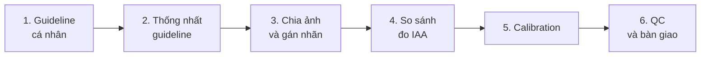

# Day 07 Lab — Guideline, Taxonomy & QC

**Nhóm 2–5 người · 4 giờ · 40 ảnh đường phố · gán box bằng CVAT**

Trạng thái QC: **Hold**. Đã chuyển mã sang MSHV và tạo vòng QC 1 hợp lệ; AI đã rà 40 ảnh, ghi kết quả 34 ảnh, sáu ảnh còn câu hỏi. Xem [báo cáo QC](submission/qc/QC_REPORT.md) và [phiếu vòng 1](submission/qc/reviews/round-01/qc_review.csv). Chưa có xác nhận reviewer là người thật.

Bạn nhận một guideline **sơ sài** và 40 ảnh chứa nhiều tình huống mà nó không nói tới.
Nhóm **viết lại guideline cho đủ dùng**, gán nhãn độc lập, đo độ đồng thuận, họp calibration,
rồi bàn giao nhãn kèm quyết định **Release / Hold / Rework**.


*Tuk-tuk, xe chở xe, tượng, xe giả tưởng, tượng pickup, ma-nơ-canh… Guideline của bạn phải xử lý được chúng.*

## Quy trình



Trọng tâm là **guideline**: nhãn chỉ tốt khi mọi người hiểu quy tắc giống nhau.

## Bắt đầu

1. Clone [repo lab](https://github.com/VinUni-AI20k/K5-L23-Day07-Guideline-Taxonomy-QC). Nộp bài bằng repo riêng tư hoặc gói nén theo hướng dẫn của coach.
2. Cài Python 3.9+ và `python -m pip install -r requirements.txt`. Dùng tài khoản CVAT của lớp.
3. Nhóm dùng **MSHV** theo [bảng ánh xạ](submission/member_ids.json), được người dùng xác nhận. Script vẫn hỗ trợ mã ba chữ số cho starter/test. Tài liệu gốc dùng mã cũ cần đọc theo bảng ánh xạ. Đọc **[GUIDE.md](GUIDE.md)** rồi **[RULES.md](RULES.md)**.

## Tài liệu

| Bạn cần | Xem |
|---|---|
| Các pha làm việc và lệnh | [GUIDE.md](GUIDE.md) |
| Mốc tiến độ 4 giờ | [CHECKPOINTS.md](CHECKPOINTS.md) |
| Quy tắc làm bài | [RULES.md](RULES.md) |
| Chấm điểm (100 điểm) | [RUBRIC.md](RUBRIC.md) |
| Gói phải nộp, cách nộp, checklist | [SUBMISSION.md](SUBMISSION.md) |
| Thông tin nhóm, kết quả tóm tắt | [TEAM.md](TEAM.md) |
| Dùng CVAT và COCO | [docs/CVAT_SETUP.md](docs/CVAT_SETUP.md) |
| Công thức, ngưỡng, cây quyết định QC | [docs/QC_CHEATSHEET.md](docs/QC_CHEATSHEET.md) |
| Mẫu báo cáo QC, ghi chú cá nhân | [docs/QC_REPORT_TEMPLATE.md](docs/QC_REPORT_TEMPLATE.md), [docs/INDIVIDUAL_NOTE_TEMPLATE.md](docs/INDIVIDUAL_NOTE_TEMPLATE.md) |
| Các lệnh và file đầu ra | [scripts/README.md](scripts/README.md) |
| Guideline khởi đầu (v0), khung viết guideline | [guideline/](guideline/) |
| Nguồn và giấy phép ảnh | [data/README.md](data/README.md) |
| **Coach:** chuẩn bị lớp, ma trận kiểm thử | [docs/COACH_GUIDE.md](docs/COACH_GUIDE.md), [docs/TEST_MATRIX.md](docs/TEST_MATRIX.md) |

## Định danh của nhóm

Các file nhãn và danh sách ảnh dùng MSHV. Không cần chia ảnh lại khi đã có assignment.csv. Lệnh chia ảnh tương thích ánh xạ đã xác nhận:

```powershell
python scripts/split_assign.py --members 2A202603289,2A202603292,2A202603280,2A202603278 --copy-images
```

Thứ tự mã cũ được giữ để tái tạo đúng phân công. Xem [TEAM.md](TEAM.md) và [kiểm chứng](submission/qc/migration_mshv/verification.json).
